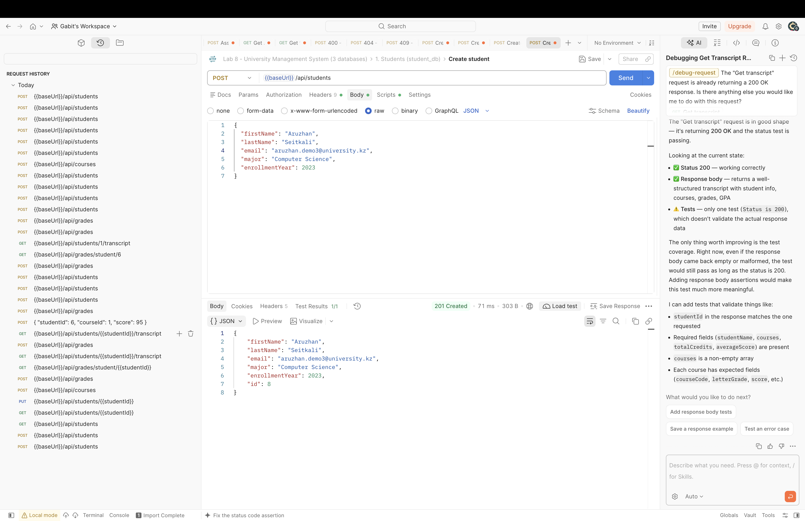
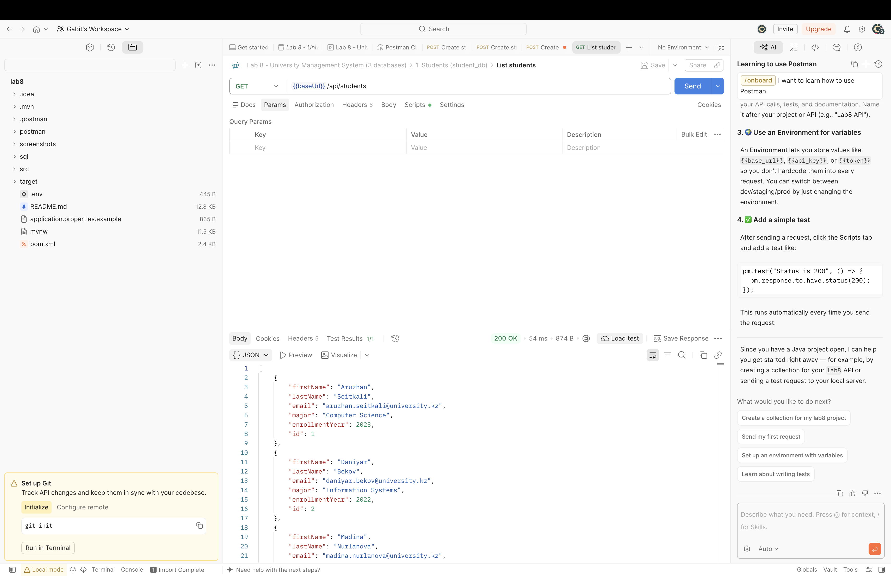
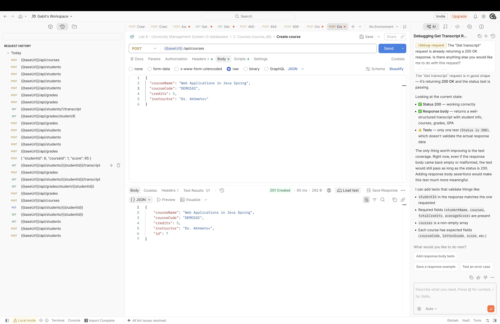
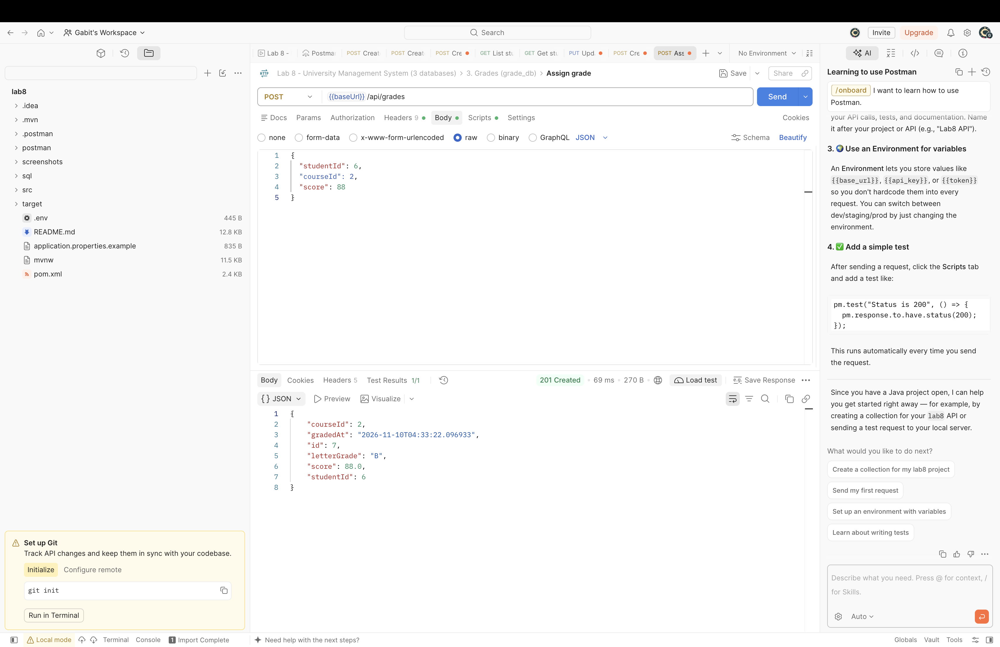
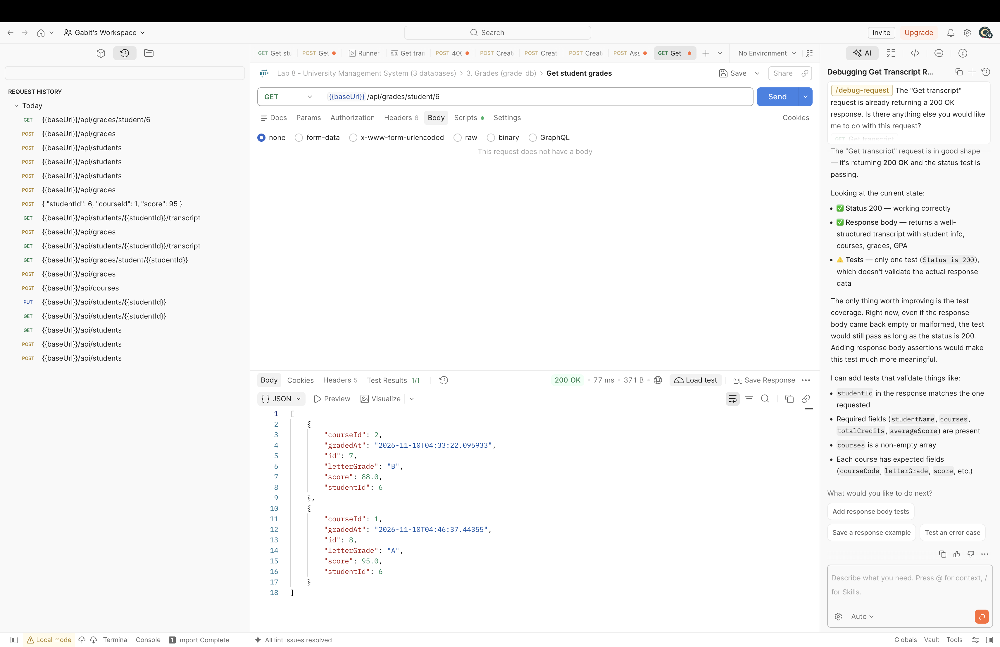
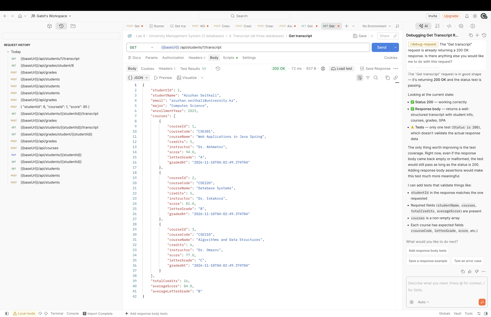
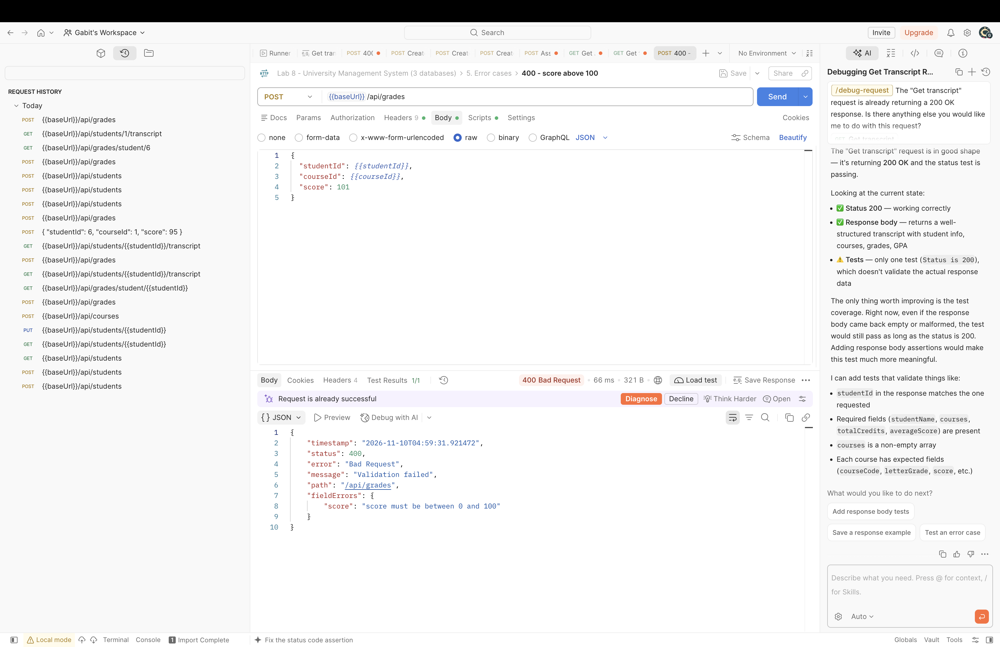
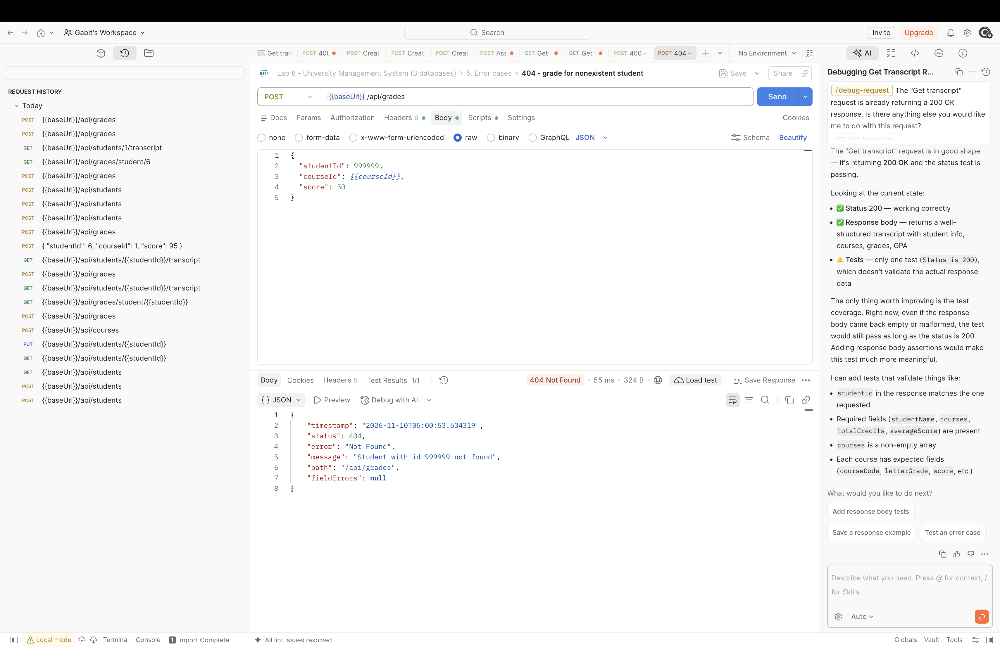
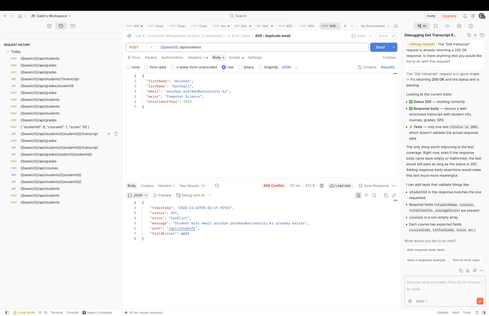
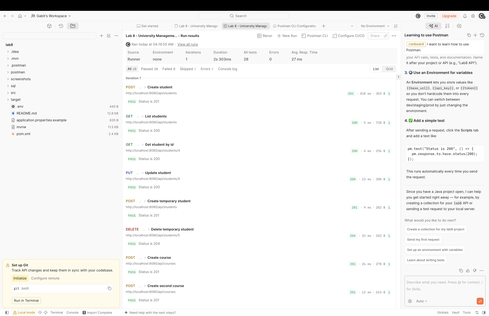

# Laboratory Work No. 8: University Management System

One Spring Boot application connected to **three independent PostgreSQL databases**
(`student_db`, `course_db`, `grade_db`). It has a layered architecture, a separate JPA configuration
for each database, REST CRUD APIs, validation, and an endpoint that combines data from all three databases.

**Stack:** Java 21, Spring Boot 4.1.1, Spring Data JPA (Hibernate 7), Bean Validation, PostgreSQL, Maven.

---

## 1. Architecture

```
Postman ──► REST Controllers ──► Services (business logic, validation, cross-DB checks)
                                     │
                                     ▼
                         Spring Data JPA Repositories
          ┌──────────────────────────┼──────────────────────────┐
StudentRepository            CourseRepository            GradeRepository
studentEntityManagerFactory  courseEntityManagerFactory  gradeEntityManagerFactory
studentTransactionManager    courseTransactionManager    gradeTransactionManager
          │                          │                          │
      student_db                 course_db                  grade_db
```

`grades.student_id` and `grades.course_id` are **logical references**, not foreign keys.
PostgreSQL cannot enforce a foreign key that points to a different database, so `GradeService` checks
that the student and course exist before it saves a grade. `StudentService` and `CourseService` refuse
to delete a record that still has grades, so no orphaned grades are left behind.

### Project structure

```
src/main/java/com/example/lab8
├── config/      StudentDatabaseConfig, CourseDatabaseConfig, GradeDatabaseConfig, DatabaseConfigSupport
├── student/     entity/Student, repository/StudentRepository, service/StudentService, controller/StudentController
├── course/      entity/Course,  repository/CourseRepository,  service/CourseService,  controller/CourseController
├── grade/       entity/Grade,   repository/GradeRepository,   service/GradeService,   controller/GradeController
├── dto/         StudentTranscriptDto, GradeRequest
└── exception/   GlobalExceptionHandler, ErrorResponse, ResourceNotFoundException, ConflictException
sql/             database and table creation scripts with sample data
postman/         Postman collection
```

### How the three databases are separated

Each `*DatabaseConfig` class declares its own three beans and binds one repository package to them:

```java
@EnableJpaRepositories(
        basePackages = "com.example.lab8.student.repository",
        entityManagerFactoryRef = "studentEntityManagerFactory",
        transactionManagerRef = "studentTransactionManager")
```

- `studentDataSource`: a HikariCP pool built from the `app.datasource.student.*` properties
- `studentEntityManagerFactory`: scans only `com.example.lab8.student.entity`
- `studentTransactionManager`: a `JpaTransactionManager` for that factory

Writes in each service name their transaction manager explicitly, for example
`@Transactional(transactionManager = "gradeTransactionManager")`. None of the three is marked `@Primary`,
so a `@Transactional` that names no manager fails with `NoUniqueBeanDefinitionException` instead of silently using the wrong database.

---

## 2. Setup

### 2.1 Create the databases

```bash
psql -U postgres -f sql/00_create_databases.sql
psql -U postgres -d student_db -f sql/01_student_db.sql
psql -U postgres -d course_db  -f sql/02_course_db.sql
psql -U postgres -d grade_db   -f sql/03_grade_db.sql
```

The table scripts are idempotent and add sample data (3 students, 3 courses, 4 grades).
If you skip them, Hibernate creates the tables on its own (`JPA_DDL_AUTO=update`), but without sample data
and without the `CHECK` constraints.

### 2.2 Configure credentials

`src/main/resources/application.properties` reads every credential from an environment variable.
It also imports a local `.env` file from the project root if one exists
(`spring.config.import=optional:file:.env[.properties]`). Create it from the template and set your values:

```bash
cp application.properties.example .env
```

`.env` is listed in `.gitignore`, so passwords never reach GitHub. Real environment variables
take precedence over `.env`. Without either, the URLs default to `localhost:5432` and the user to `postgres`.

To use the same values with `psql` in a terminal, load them into the shell:

```bash
set -a; source .env; set +a
```

### 2.3 Run

From IntelliJ IDEA: open `Lab8Application` and press Run. No extra run configuration is needed,
because the app reads `.env` itself.

From a terminal:

```bash
./mvnw spring-boot:run
```

The API runs at `http://localhost:8080`.

### 2.4 Automated tests

```bash
./mvnw test
```

`Lab8ApplicationTests` starts the whole application against **three separate in-memory H2 databases**
(PostgreSQL mode), so it needs no PostgreSQL server. It checks that each table exists only in its own database,
then calls every endpoint and every error case.

---

## 3. REST API

| Method | Endpoint | Function | Database(s) |
|---|---|---|---|
| GET | `/api/students` | List students | student_db |
| GET | `/api/students/{id}` | Get one student | student_db |
| POST | `/api/students` | Create student | student_db |
| PUT | `/api/students/{id}` | Update student | student_db |
| DELETE | `/api/students/{id}` | Delete student (409 if the student has grades) | student_db + grade_db check |
| GET | `/api/courses` | List courses | course_db |
| GET | `/api/courses/{id}` | Get one course | course_db |
| POST | `/api/courses` | Create course | course_db |
| PUT | `/api/courses/{id}` | Update course | course_db |
| DELETE | `/api/courses/{id}` | Delete course (409 if the course has grades) | course_db + grade_db check |
| POST | `/api/grades` | Assign grade | grade_db + student/course checks |
| GET | `/api/grades` | List all grades | grade_db |
| GET | `/api/grades/{id}` | Get one grade | grade_db |
| GET | `/api/grades/student/{id}` | Get a student's grades | grade_db (+ student check) |
| PUT | `/api/grades/{id}` | Change a grade | grade_db + student/course checks |
| DELETE | `/api/grades/{id}` | Delete a grade | grade_db |
| GET | `/api/students/{id}/transcript` | Combined student, course and grade data | **all three** |

### Example requests

```http
POST /api/students
{"firstName":"Aruzhan","lastName":"Seitkali","email":"aruzhan@university.kz","major":"Computer Science","enrollmentYear":2023}

POST /api/courses
{"courseName":"Web Applications in Java Spring","courseCode":"CSE301","credits":5,"instructor":"Dr. Akhmetov"}

POST /api/grades
{"studentId":1,"courseId":1,"score":94}
```

The server computes `letterGrade` (A ≥ 90, B ≥ 80, C ≥ 70, D ≥ 60, otherwise F) and sets `gradedAt`.
Each student can have only one grade per course; use `PUT /api/grades/{id}` to change it.

### Transcript (final challenge)

`GET /api/students/1/transcript` with the sample data returns:

```json
{
  "studentId": 1,
  "studentName": "Aruzhan Seitkali",
  "email": "aruzhan.seitkali@university.kz",
  "major": "Computer Science",
  "enrollmentYear": 2023,
  "courses": [
    {"courseId": 1, "courseCode": "CSE301", "courseName": "Web Applications in Java Spring",
     "credits": 5, "instructor": "Dr. Akhmetov", "score": 94.0, "letterGrade": "A", "gradedAt": "..."},
    {"courseId": 2, "courseCode": "CSE220", "courseName": "Database Systems",
     "credits": 5, "instructor": "Dr. Iskakova", "score": 81.0, "letterGrade": "B", "gradedAt": "..."},
    {"courseId": 3, "courseCode": "CSE210", "courseName": "Algorithms and Data Structures",
     "credits": 6, "instructor": "Dr. Omarov", "score": 77.0, "letterGrade": "C", "gradedAt": "..."}
  ],
  "totalCredits": 16,
  "averageScore": 84.0,
  "averageLetterGrade": "B"
}
```

`GradeService.getTranscript` builds it in three steps:
1. It loads the student from **student_db** (404 if the student is not found).
2. It loads the student's grades from **grade_db**.
3. It loads every referenced course from **course_db** in one `findAllById` query, then joins the results in memory.

### Error responses

All errors share one JSON shape, produced by `GlobalExceptionHandler` (`@RestControllerAdvice`):

```json
{"timestamp":"...","status":409,"error":"Conflict",
 "message":"Student with email aruzhan@university.kz already exists","path":"/api/students","fieldErrors":null}
```

| Status | When |
|---|---|
| 400 | Bean validation failed (with `fieldErrors`), score outside 0–100, malformed JSON, non-numeric id |
| 404 | Student, course or grade not found, including a grade for a nonexistent student or course |
| 409 | Duplicate email, duplicate course code, duplicate grade for the same student and course, deleting a student or course that still has grades |
| 503 | One of the databases cannot be reached |

---

## 4. Transactions across three databases

### Why local JPA transactions are not atomic across the three databases

Each `JpaTransactionManager` controls **one** `EntityManagerFactory`, which uses **one** JDBC connection
to **one** database. A `@Transactional(transactionManager = "gradeTransactionManager")` method
can only commit or roll back work in `grade_db`.

When one business operation writes to two databases, it runs two separate local transactions:

```
begin tx on student_db ... commit   ✔
begin tx on grade_db   ... FAILS    ✘   → student_db is NOT rolled back
```

To get atomicity, all three databases would have to agree to commit together. That requires a
**distributed transaction** using two-phase commit (XA/JTA, for example Atomikos or Narayana) or a
compensation pattern such as Saga or the outbox pattern. The lab does not require distributed transactions,
so this project accepts the limitation and keeps it small:

- Each write operation changes **only one** database. Cross-database steps are only *reads*
  that check existence before the write.
- Deletes are blocked while references still exist, instead of being cascaded to another database.

A small race still remains. For example, a student could be deleted between the existence check and the moment
the grade is saved, and a "check-then-act" across databases cannot prevent that without a distributed lock
or transaction.

### Consistency risks when one database is unavailable

| Database down | Effect |
|---|---|
| **student_db** | Student CRUD and transcript fail with 503. A new grade cannot be assigned, because the student check fails. Existing grades can still be read with `/api/grades`. |
| **course_db** | Course CRUD fails. A new grade cannot be assigned. The transcript fails with 503, because the course read throws, so the client does not get a half-built transcript. |
| **grade_db** | Students and courses still work, but **delete is blocked** (503), because the service cannot confirm there are no grades. This protects against orphaned grades. Transcript and grade endpoints fail. |

Other risks to explain at the defense:
- **Partial or stale reads:** the transcript reads three databases at three different moments,
  so it is not a consistent snapshot. A grade written between step 2 and step 3 may be missing.
- **Orphaned references:** if someone deletes a row directly in SQL and bypasses the service,
  grades can point to records that no longer exist. The transcript then shows `"Unknown course (id N)"`
  instead of crashing.
- **No cross-database rollback:** if a future feature writes to two databases (for example "delete a student and
  their grades"), a failure between the two commits leaves the data inconsistent. Fixing that needs XA/2PC,
  a Saga with compensating actions, or a retry/outbox mechanism.

---

## 5. Testing with Postman

1. Import `postman/Lab8_University_API.postman_collection.json`.
2. Start the application, then run the collection with **Runner**, folders 1 to 5 in order.
   Each request has a status-code test, and the ids of created records are saved to collection variables.
3. The collection uses unique email and course codes (`*.postman@...`, `PM301`, `PM220`), so it does not clash
   with the sample data. To run it a second time, reset the databases or change those values.

### Screenshots

**Create student: POST /api/students → 201 Created**



**List students: GET /api/students → 200 OK**



**Create course: POST /api/courses → 201 Created**



**Assign grade: POST /api/grades → 201 Created (letter grade computed by the server)**



**Student grades: GET /api/grades/student/{id} → 200 OK**



**Transcript (final challenge): GET /api/students/1/transcript, data from all three databases**



**400 Bad Request: score above 100**



**404 Not Found: grade for a nonexistent student**



**409 Conflict: duplicate email**



**Postman Runner: 28 of 28 tests passed**



---

## 6. Team and contributions

| Member | Contribution |
|---|---|
| Gabit Mukan | Individual work: all three database configurations, Student, Course and Grade modules, cross-database transcript, error handling, SQL scripts, Postman collection and testing, README |
